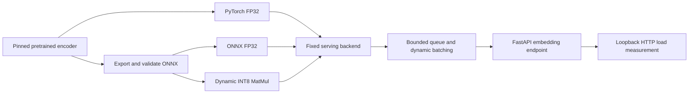

# ServeBench

Measured CPU model-serving optimization: the same pretrained text encoder under PyTorch FP32, ONNX Runtime FP32 and dynamic INT8 MatMul quantization. Includes bounded admission, dynamic batching, deadlines, a real HTTP load generator and a local semantic-search demo.

Verified local CPU run: batch-1 isolated p50 was **10.27 ms / 4.03 ms / 2.96 ms** for PyTorch / ONNX FP32 / ONNX INT8. All **960 normal HTTP requests** succeeded. Batching did not improve concurrency-8 goodput in this run, and INT8 changed four of 24 top retrieval results. See [measured results and limitations](RESULTS.md), [verification evidence](VALIDATION.md) and the [full frozen report](benchmarks/run-v2.json).

## What this measures

The base is [sentence-transformers/paraphrase-MiniLM-L3-v2](https://huggingface.co/sentence-transformers/paraphrase-MiniLM-L3-v2), Apache-2.0, pinned to revision `4ca70771034acceecb2e72475f72050fcdde4ddc`. The actual pretrained weights produce 384-dimensional embeddings. All backends use the same tokenizer, attention-mask mean pooling, L2 normalization and explicit 128-token limit. Overlength input is rejected, never silently truncated. There is no remote inference API, fine-tuning or paid service.



Two measurement layers prevent confusing model speed with service behavior:

- **Isolated forward:** pretokenized inputs, batches 1 and 8, 5 warm-ups and 48 timed calls per size. Includes tensor conversion and model execution, excluding tokenization, queueing, HTTP and serialization. Default 48 calls complete balanced cycles of the fixed short/long workload; batch padding patterns still differ.
- **End-to-end:** real Uvicorn processes, loopback HTTP, identical mixed-length requests, concurrency 1 and 8, batching off/on, successful p50/p95, all-attempt latency, goodput and error rates. A separate short-deadline burst exercises overload behavior.

The quality set contains 24 self-authored fictional help documents and 24 paraphrased queries with one designated relevant document each. Recall@1, Recall@3, MRR, embedding drift and top-1 agreement to PyTorch are measured. No benchmark inputs train, calibrate or select the model. This tiny authored set is not an independent real-customer benchmark. See [DATA_CARD.md](DATA_CARD.md).

Quality encoding uses batches of 8. Dynamic INT8 output may depend on batch composition; quality under every API batching pattern has not been established.

## Setup — Python 3.11, CPU

```powershell
python -m venv .venv
.\.venv\Scripts\python.exe -m pip install --upgrade pip
.\.venv\Scripts\python.exe -m pip install torch==2.10.0 --index-url https://download.pytorch.org/whl/cpu
.\.venv\Scripts\python.exe -m pip install -r requirements.txt
.\.venv\Scripts\python.exe download_model.py
.\.venv\Scripts\python.exe export_model.py
.\.venv\Scripts\python.exe -m unittest discover -s tests -v
```

The model downloader validates pinned safetensors weights against upstream SHA-256. Local inference checks source and exported-artifact hashes and disables remote model code. `private/` contains model artifacts and is not committed. Re-run the download/export steps on another machine.

`requirements-lock-windows.txt` records the exact verified Windows/Python 3.11 CPU environment. Use the official CPU index as an extra package source if installing this lock; the `torch==2.10.0+cpu` wheel is not supplied by ordinary PyPI. The bounded requirements are used separately for the unexecuted Linux CI/Docker scaffolds.

## Run actual measurements

Close other model demos/heavy applications first; do not run the search UI concurrently with a benchmark.

```powershell
.\.venv\Scripts\python.exe -X utf8 run_benchmarks.py --output reports/my-run.json
```

This performs all three actual model benchmarks and six sequential single-worker API configurations. Each uses two inference threads, max batch 1 or 8, 0 or 5 ms batching wait, and an admission queue of 16. Each configuration receives 80 requests at concurrency 1 and another 80 at concurrency 8, after three warm-up requests. Reports include raw latency/status samples. Existing final output filenames are not overwritten; use a new filename for a new run. Temporary per-backend files/server logs under `reports/` may be replaced; preserve a complete report when comparing runs.

Every backend/configuration is measured in a fresh process. RSS is sampled at 10 ms intervals and includes Python, imported libraries, tokenizer and model, not just weights. The CPU-only PyTorch import is present in all backends. RSS is not GPU memory or an exact allocator peak. Isolated-process memory sampling begins before engine load. HTTP memory sampling begins after readiness and follows the actual API worker PID, validated as a descendant of the launched process; it excludes startup/model-load peaks. This matters on Windows where the virtual-environment launcher can be a separate small process.

The load generator uses closed-loop concurrent workers and HTTP keep-alive with no retries. Fast 429/504 errors are not counted as successful throughput. These measurements do not establish open-loop capacity, public Internet latency, sustained production load, distributed scale or a universal speedup. A single run has uncontrolled power/thermal/background-task effects. INT8 may be slower or change retrieval results; keep those outcomes.

## API

```powershell
$env:SERVEBENCH_BACKEND = "onnx-int8"
.\.venv\Scripts\python.exe -m uvicorn api:app --host 127.0.0.1 --port 8520 --workers 1
```

Open `http://127.0.0.1:8520/docs`. `POST /embed` body:

```json
{"text":"How do I stop automatic monthly renewals?","timeout_ms":2000}
```

The response contains a 384-value normalized embedding, observed batch size and server timing. `/metrics` shows cumulative queue/batch/outcome counters. A fixed backend per server process avoids accidental cross-backend mixing. Environment options: `SERVEBENCH_THREADS` (default 2), `SERVEBENCH_BATCH` (8), `SERVEBENCH_WAIT_MS` (5), `SERVEBENCH_QUEUE` (16).

- 422: invalid input or more than 128 tokens.
- 429: admission queue full; no hidden retry.
- 504: request deadline expired.

There is one executor inference worker and at most one running batch. The queue bounds waiting requests, while the current batch may contain up to 8 more. A timed-out running native inference call cannot be interrupted safely: it finishes on the same worker, its late result is discarded, and no extra worker is spawned. A batch containing an invalid text does not invalidate its neighbors. Token-limit validation and the final batch tokenize occur in the inference worker; that preprocessing overhead is included in HTTP results. This queue/deadline demonstration is not authentication or a public deployment policy.

Optional separate load test against the running API:

```powershell
.\.venv\Scripts\python.exe load_test.py --requests 80 --concurrency 8 --output reports/custom-load.json
```

## Local search demo

```powershell
.\.venv\Scripts\python.exe -m streamlit run app.py --server.address 127.0.0.1 --server.port 8518
```

The UI shows measured tables and searches the authored documents with the selected actual local engine. Its search timer excludes model/corpus load. It does not measure HTTP service latency. Similarity scores are not probabilities.

## Test and deployment scope

Unit tests use explicit fake inference functions to check queue bounds, result mapping, partial batches, deadline/cancellation behavior, failure recovery, API input validation and metric arithmetic. Real model/export/HTTP checks are performed separately by the benchmark scripts. A unit-test count is not a quality score.

Docker and CI configuration are scaffolds unless execution is explicitly recorded in the validation document. The API has no authentication and is intended for loopback. No input data is sent to an inference provider. Do not expose this demo publicly or submit sensitive customer data.

References: [ONNX Runtime quantization](https://onnxruntime.ai/docs/performance/model-optimizations/quantization.html), [PyTorch 2.10 ONNX export](https://docs.pytorch.org/docs/2.10/onnx.html). INT8 here refers to supported dynamically quantized MatMul weights; embeddings, normalization and other operations remain floating point.
